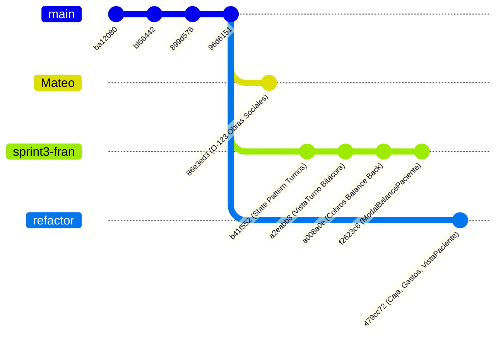

# Auditoría Técnica y Análisis Comparativo de Ramas Git
**Repositorio:** `consultorioMyV`  
**Rama Base Auditada (`HEAD`):** `moduloInicioSesion` (Hash: `a376e1a`)  
**Fecha de Auditoría:** 23 de Octubre de 2026  
**Auditor:** Tech Lead & Arquitecto de Software  

---

## 1. Diagnóstico Estructural de Historia Git (Hallazgo Crítico)

> [!CAUTION]
> **Alerta de Historial Desacoplado (`unrelated histories`):**
> La rama de trabajo actual `moduloInicioSesion` posee una raíz independiente (Commit inicial: `188378b` - *valentin*), mientras que las tres ramas remotas (`origin/refactor/reestructuracion-proyecto`, `origin/sprint3-fran` y `origin/Mateo`) descienden del árbol genealógico de `origin/main` (Commit inicial: `a9cb9ce` - *nicopereira2802*).
> Un intento de ejecución de `git merge` estándar arroja:
> `fatal: refusing to merge unrelated histories`
> Si se fuerza con `--allow-unrelated-histories`, Git interpreta los archivos coincidentes como conflictos de tipo `add/add` en más de 80 ficheros.

### Relación entre las 3 Ramas Remotas
Las tres ramas remotas comparten una base común reciente: el commit **`96d6151`** (*"Correccion de txt"*). A partir de allí, se bifurcaron en diferentes frentes funcionales del Sprint 3:

---

## 2. Análisis Detallado por Rama Remota

### Rama 1: `origin/refactor/reestructuracion-proyecto`
- **Último Commit:** `479cc72` (*"Balance, Gastos, Cobro, Reacomodamiento de codigo"* - Mateo Aronna)
- **Archivos Modificados vs HEAD:** 112 archivos (+17.390 / -7.108 líneas)

#### 1. Resumen Funcional
Esta rama introduce la infraestructura contable y financiera completa de la clínica (Caja y Gastos), además de mejoras sustanciales en la vista de pacientes y organización de turnos:
1. **Módulo de Caja y Balances (`frontend/src/features/caja/GestionCaja.jsx`):** Vista general de ingresos vs. egresos, flujo de efectivo y balance neto del consultorio.
2. **Módulo de Gastos (`frontend/src/features/gastos/GestionGasto.jsx`):** CRUD de gastos operativos, gestión de categorías de gastos, hooks dedicados y modales de carga.
3. **Ficha Integral de Paciente (`frontend/src/features/pacientes/components/VistaPaciente.jsx`):** Modal/drawer detallado que visualiza antecedentes, edad calculada, obras sociales y turnos históricos.
4. **Reestructuración de Turnos:** Desacople de hooks (`useTurnoDependencies`, `useTurnoAtenderModal`), mapas de estados y nuevo componente `BotonAcciones.jsx`.

#### 2. Cambios Nuevos No Implementados en Nuestra Rama
- **Directorios y Componentes Frontend:**
  - `src/features/caja/GestionCaja.jsx`
  - `src/features/gastos/` (`GestionGasto.jsx`, `FormulariosGasto.jsx`, `useCategoriasGastosCatalogo.jsx`, `useGastoActions.jsx`, `formatearGastoParaEditar.js`)
  - `src/features/pacientes/components/VistaPaciente.jsx`, `constants/pacienteConstants.js`, `hooks/usePacienteVer.jsx`, `utils/calcularEdad.js`
  - `src/features/turnos/components/BotonAcciones.jsx`, `utils/estadosMap.jsx`, `hooks/useTurnoDependencies.jsx`
- **Backend (Modelos, Controladores, Rutas y Esquemas):**
  - `CategoriaGasto` (`.model.js`, `.controller.js`, `.routes.js`, `.schema.js`)
  - `Gasto` (`.model.js`, `.controller.js`, `.routes.js`, `.schema.js`)
  - Endpoints montados en `backend/routes/index.routes.js`: `/api/gastos` y `/api/categorias-gastos`
- **Dependencias:**
  - Frontend: `"react-hot-toast": "^2.6.1"` (incorporada para toasts unificados).
  - Backend: Sin dependencias nuevas.

#### 3. Alertas de Conflicto Crítico (Puntos de Choque)
- **Base de Datos / Modelos (`Usuario.model.js`):** ⚠️ **CRÍTICO.** Su versión carece de las columnas de seguridad implementadas en nuestra rama: `pin`, `email`, `reset_token`, `reset_token_expires` y la restricción `unique: true` en `nombre_usuario`.
- **Servicio API (`src/services/api.js`):** ⚠️ **ALTO.** En esta rama, el interceptor de Axios para inyectar el Bearer Token JWT está **comentado**. Si se sobrescribe, todas las llamadas protegidas del frontend fallarán con 401.
- **Navegación / Layout (`Sidebar.jsx` y `Bottombar.jsx`):** ⚠️ **ALTO.** Eliminó el enlace directo a `/cobros` y lo reemplazó por `/caja` (*"Caja y Balances"*). **No contiene** `usePinLock`, el botón *"Cambiar PIN"*, *"Bloquear Terminal"*, ni el modal `RecuperarPinModal.jsx`.
- **Rutas de Backend (`index.js` y `index.routes.js`):** ⚠️ **CRÍTICO.** 
  - `index.routes.js` **no registra** `/api/auth` ni `/api/usuarios`.
  - `backend/index.js` eliminó `helmet()`, la configuración segura de CORS con `credentials: true` y el `errorHandler` centralizado.
  - Carece de `Usuario.controller.js` y `rateLimit.middleware.js`.

#### 4. Riesgo de Integración y Veredicto
- **Nivel de Riesgo:** **ALTO / MUY ALTO**.
- **Veredicto:** **Requiere Integración Selectiva**. No hacer `git merge` directo. Los módulos de `caja`, `gastos` y `VistaPaciente` deben importarse respetando obligatoriamente la arquitectura de seguridad de `HEAD`.

---

### Rama 2: `origin/sprint3-fran`
- **Último Commit:** `f2623c6` (*"FRONT incorporar selector de atendidos y modal de balance de paciente (HU C3)"* - Nicolas Pereira)
- **Commits Clave:** `b41f552`, `a2eabb8`, `a008a0e`, `f2623c6`
- **Archivos Modificados vs HEAD:** 93 archivos (+15.630 / -7.237 líneas)

#### 1. Resumen Funcional
Esta rama se enfoca en la robustez arquitectónica del flujo de Turnos y en la conciliación de saldos de pacientes en Cobros:
1. **Patrón State para Turnos (`backend/states/TurnoState.js`):** Manejo formal de máquinas de estado para los turnos (Programado, Atendido, Cancelado, Inasistente), blindando las transiciones válidas y registrando bitácora de auditoría histórica en `historial_estado_turno`.
2. **Modelo Intermedio `ObraSocialTurno`:** Desacopla la relación directa y permite registrar coberturas específicas asociadas al turno.
3. **Modal de Balance del Paciente (`HU C3`):** Componente `frontend/src/features/cobros/components/ModalBalancePaciente.jsx` (195 líneas) que permite liquidar y consultar deudas/saldos por paciente.
4. **Optimización de Ficha de Turno (`VistaTurno.jsx`):** Deduplicación de notas clínicas y renderizado de la bitácora de cambios de estado.
5. **Turnos Atendidos en Cobros:** Selector de turnos completados para agilizar la facturación directa.

#### 2. Cambios Nuevos No Implementados en Nuestra Rama
- **Backend:**
  - `backend/states/TurnoState.js`
  - `backend/constants/TurnoIncludes.js`
  - `backend/utils/turno.utils.js`
  - `backend/models/ObraSocialTurno.model.js`
- **Frontend:**
  - `frontend/src/features/cobros/components/ModalBalancePaciente.jsx`
  - Integración en `GestionCobro.jsx` del modal de balance y selector de atendidos.
- **Dependencias:**
  - Frontend: `"react-hot-toast": "^2.6.1"`
  - Backend: Sin dependencias nuevas.

#### 3. Alertas de Conflicto Crítico (Puntos de Choque)
- **Base de Datos / Modelos:**
  - `Usuario.model.js`: ⚠️ **CRÍTICO.** Carece de `pin`, `reset_token`, etc.
  - `models/index.model.js`: Modifica profundamente las asociaciones de Sequelize para dar soporte a `ObraSocialTurno`.
- **Controladores de Backend:**
  - `Turno.controller.js` (-499 líneas / +150 líneas) y `Cobro.controller.js` reescritos para utilizar `TurnoState` y utilidades de balance.
- **Servicio API (`api.js`):** ⚠️ **ALTO.** Interceptor de Bearer token deshabilitado (comentado).
- **Rutas de Backend:** `backend/routes/index.routes.js` no incluye `/api/auth`.
- **Navegación (`Sidebar.jsx` / `App.jsx`):** No incluye `<PinLockProvider>` ni botones de seguridad.

#### 4. Riesgo de Integración y Veredicto
- **Nivel de Riesgo:** **ALTO**.
- **Veredicto:** **Merge Posterior a la Unificación de Negocio**. El patrón State de Fran y su modal de balance son piezas centrales de la lógica clínica, pero deben montarse sobre una base que mantenga el middleware de autenticación y las tablas de usuario seguras.

---

### Rama 3: `origin/Mateo`
- **Último Commit:** `86e3ed3` (*"[O-123] Backend: Gestión Completa de Obras Sociales"* - Juan Gómez)
- **Archivos Modificados vs HEAD:** 93 archivos (+15.094 / -6.963 líneas vs HEAD; solo 6 archivos respecto al ancestro común `96d6151`).

#### 1. Resumen Funcional
Implementa la historia de usuario `[O-123]` centrada exclusivamente en la gestión integral de Obras Sociales en el backend:
1. **Ampliación del Modelo `ObraSocial`:** Se incorporan los campos `razon_social` (obligatorio, con hook `beforeValidate` que copia el nombre si viene vacío), `telefono` y `email`.
2. **Búsqueda Avanzada y Paginación:** Búsqueda combinada por `nombre`, `razon_social` o `telefono` con ordenamiento seguro en `ObraSocial.controller.js`.
3. **Toggle Activo/Inactivo y Eliminación Definitiva:** Endpoints para alternar el estado operativo de una mutual sin borrarla físicamente (`toggleObraSocial`) y borrado final (`deleteObraSocial`).
4. **Validaciones Zod y Tests Automatizados:** Esquemas en `ObraSocial.schema.js` y 172 líneas de pruebas en `tests/ObraSocial.test.js`.
5. **Datos Iniciales (`init_db.sql`):** Seeds actualizados con razones sociales y números de contacto reales para OSDE, Swiss Medical, PAMI y Apross.

#### 2. Cambios Nuevos No Implementados en Nuestra Rama
- `backend/tests/ObraSocial.test.js`
- Métodos `toggleObraSocial` y `deleteObraSocial` en `ObraSocial.controller.js`.
- Columnas `razon_social`, `telefono` y `email` en `ObraSocial.model.js`.
- Actualización de `init_db.sql`.

#### 3. Alertas de Conflicto Crítico (Puntos de Choque)
- **Base de Datos / Modelos (`Usuario.model.js`):** ⚠️ Mismo riesgo común: no tiene las columnas de PIN. Sin embargo, en `ObraSocial.model.js` **no hay colisión con autenticación**.
- **Rutas de Backend (`index.routes.js`):** No incluye `/api/auth`.
- **Impacto Frontend:** Nulo. No modificó componentes visuales más allá de los heredados de `96d6151`.

#### 4. Riesgo de Integración y Veredicto
- **Nivel de Riesgo:** **MEDIO / BAJO**.
- **Veredicto:** **Fácilmente Integrable**. Es la rama más limpia y modular de las tres. Sus cambios en `ObraSocial` pueden incorporarse sin alterar el sistema de autenticación ni generar conflictos de UI.

---

## 3. Matriz Comparativa de Conflictos Críticos

| Componente / Archivo Sensible | Nuestra Rama (`HEAD`) | `refactor/reestructuracion` | `sprint3-fran` | `Mateo` | Resolución Requerida |
| :--- | :--- | :--- | :--- | :--- | :--- |
| **`Usuario.model.js`** | `pin`, `email`, `reset_token`, `unique` | Modelo básico antiguo | Modelo básico antiguo | Modelo básico antiguo | **PRESERVAR HEAD** obligatoriamente |
| **`backend/package.json`** | `bcryptjs`, `jwt`, `rate-limit`, `helmet`, `nodemailer` | Sin dependencias de seguridad | Sin dependencias de seguridad | Sin dependencias de seguridad | **PRESERVAR HEAD** |
| **`routes/index.routes.js`** | Monta `/api/auth` y `/api/usuarios` | Monta `/gastos` y `/caja` | Estándar anterior | Estándar anterior | **FUSIÓN MANUAL**: Conservar auth y agregar gastos |
| **`backend/index.js`** | `helmet`, CORS seguro con credenciales | CORS genérico sin helmet | CORS genérico sin helmet | CORS genérico sin helmet | **PRESERVAR HEAD** |
| **`src/services/api.js`** | Interceptor Bearer JWT activo | Interceptor comentado | Interceptor comentado | Interceptor comentado | **PRESERVAR HEAD** |
| **`Sidebar.jsx`** | "Cambiar PIN", "Bloquear Terminal", modal PIN | Agrega `/caja`, quita `/cobros` | Estándar con `/cobros` | Estándar con `/cobros` | **FUSIÓN**: Incrustar botones PIN en menú con `/caja` |
| **`App.jsx`** | `<PinLockProvider>` envolviendo router | Rutas `/caja` y `/gastos` | Estándar | Estándar | **FUSIÓN**: Envolver rutas de caja/gastos con `PinLockProvider` |
| **`ObraSocial.model.js`** | Estándar (`nombre`, `activo`) | Estándar | Estándar | Agrega `razon_social`, `telefono` | **TOMAR RAMA MATEO** |
| **`TurnoState.js` & Auditoría**| No disponible | Parcial en controlador | Implementado con State Pattern | Estándar | **TOMAR RAMA FRAN** |
| **Caja y Gastos Frontend** | No disponible | Implementado completo | No disponible | No disponible | **TOMAR RAMA REFACTOR** |

---

## 4. Hoja de Ruta y Recomendación de Integración (Estrategia del Tech Lead)

Para evitar la corrupción del módulo de seguridad y resolver la divergencia de historiales sin pérdida de código, se debe seguir la siguiente secuencia:

### Fase 1: Consolidación Remota en una Rama de Integración (`integration/sprint3`)
Las ramas `origin/Mateo`, `origin/sprint3-fran` y `origin/refactor/reestructuracion-proyecto` **sí comparten ancestro común (`96d6151`)**. Deben fusionarse primero entre sí:
1. Crear una rama de integración desde `origin/refactor/reestructuracion-proyecto`.
2. Mergear `origin/Mateo` (incorpora Obras Sociales sin fricción).
3. Mergear `origin/sprint3-fran` resolviendo los choques entre el `Turno.controller.js` de Fran y los gastos/caja de Mateo Aronna.
4. Validar que la suite de tests de backend y el build de frontend pasen exitosamente.

### Fase 2: Portabilidad de la Capa de Autenticación y Seguridad
Dado que `moduloInicioSesion` tiene un commit raíz desacoplado:
1. No realizar `git merge` directo sobre la rama de trabajo sucia.
2. Trasplantar los archivos atómicos de seguridad a la rama consolidada:
   - Ficheros de Frontend: `src/context/PinLockContext.jsx`, `src/components/PinLogin.jsx`, `src/components/PinLogin.css`, `src/components/LoginMaestro.jsx`, `src/components/RecuperarPinModal.jsx`, `src/components/RecuperarPasswordModal.jsx`, `src/services/auth.service.js`.
   - Ficheros de Backend: `backend/controllers/Usuario.controller.js`, `backend/middleware/rateLimit.middleware.js`, `backend/middleware/auth.middleware.js`, `backend/routes/Usuario.routes.js`, `backend/schemas/Usuario.schema.js`.
3. Aplicar los parches de interconexión en los 5 archivos compartidos:
   - `Usuario.model.js`: Mantener columnas `pin`, `email`, `reset_token`, `reset_token_expires`.
   - `backend/index.js`: Mantener Helmet y CORS seguro.
   - `routes/index.routes.js`: Mantener `/api/auth` y `/api/usuarios`.
   - `api.js`: Interceptor con Bearer Token activo.
   - `App.jsx` y `Sidebar.jsx`: `<PinLockProvider>` y botones de Bloqueo/Cambio de PIN integrados en la nueva navegación de Caja y Gastos.
